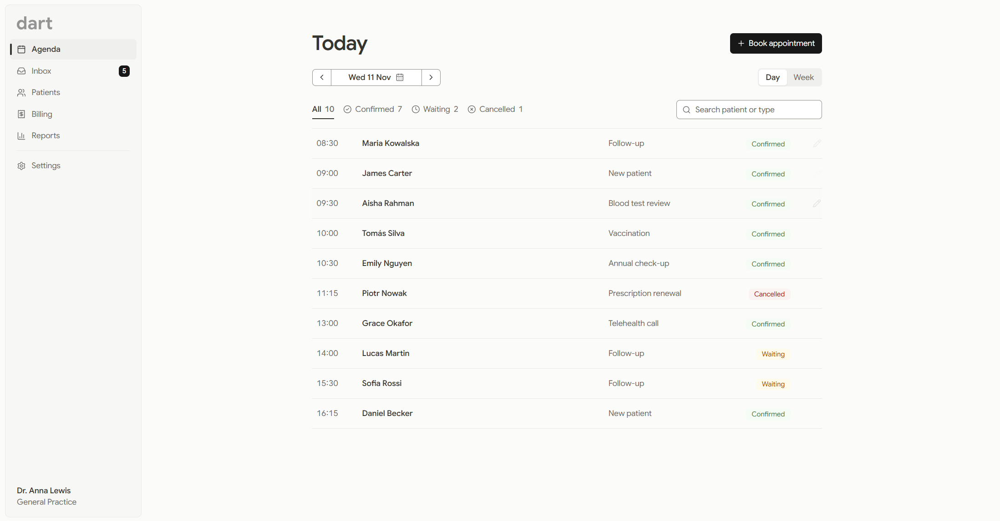
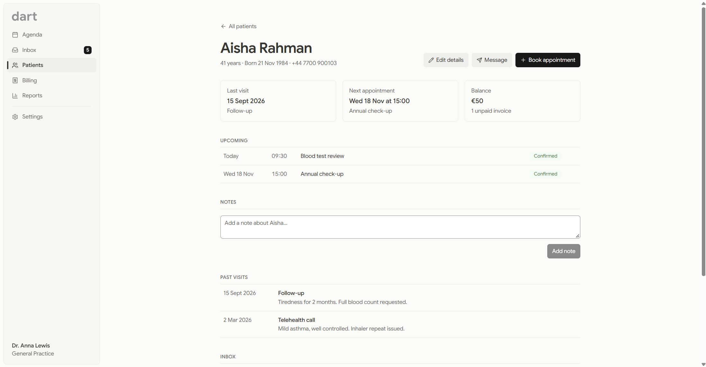
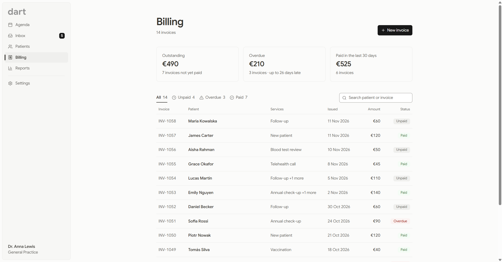
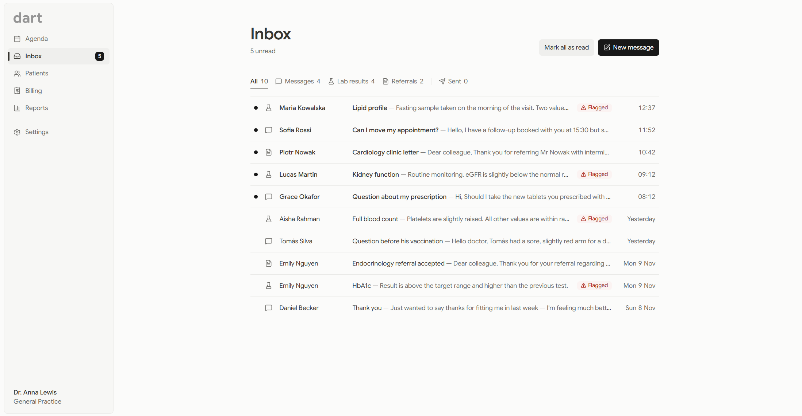
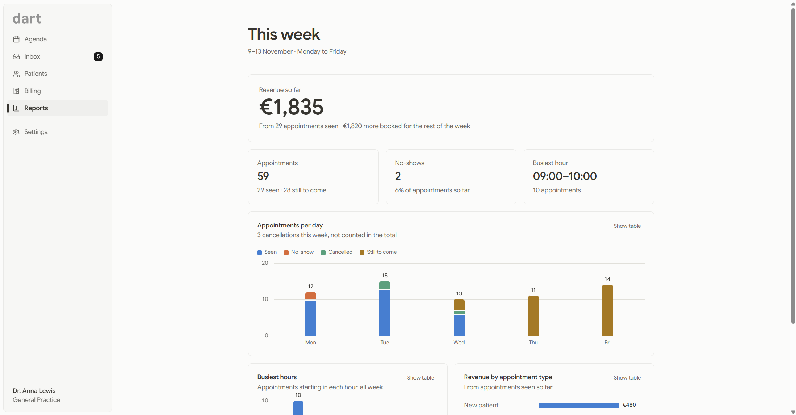
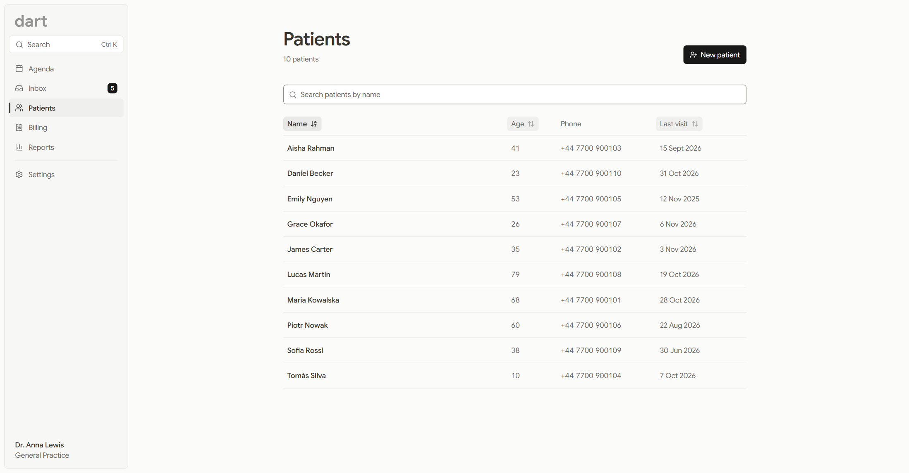
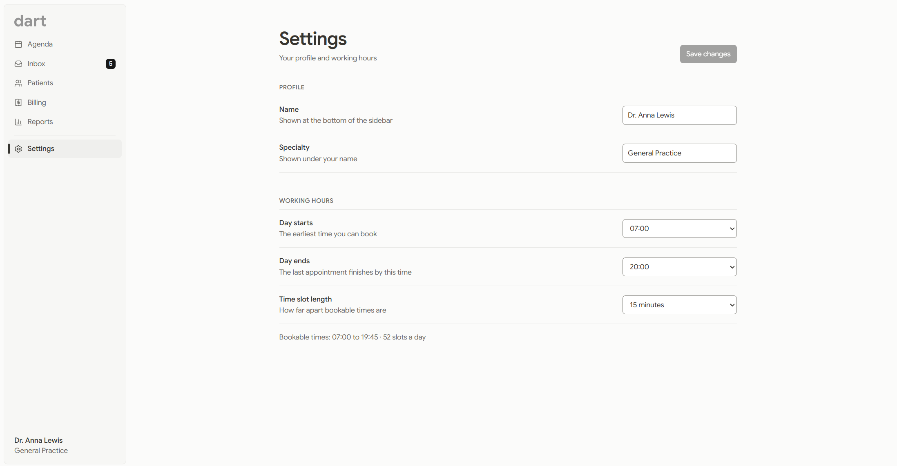

# Dart

**A calm workspace for clinicians: agenda, inbox, patient records, billing and reports in one place.**

Dart is a design and front-end prototype of the software a general practitioner works in all day. It's built to feel quiet and fast, to show dense information without feeling crowded, and to hold up next to the best tools outside healthcare.

> This is a portfolio project. All patients, clinicians and results are fictional, and nothing is sent or stored on a server.



---

## What's inside

| Screen | What you can do |
| --- | --- |
| **Agenda** | Switch between a day view and a Monday-to-Friday week view, move to the previous or next day or week, or jump to any date. Filter by status (confirmed, waiting, cancelled), search by patient or type, and book, edit or delete appointments. A clear empty state when the day is free. |
| **Inbox** | Patient messages, lab results and referral letters in one list, filtered by kind. Out-of-range lab values are flagged. Reply to messages and letters, message the patient about a result, or write a new message. A Sent tab keeps everything you've sent, and the sidebar shows the unread count. |
| **Patients** | A sortable table (name, age, last visit) with search. Add new patients, and open any patient's record. |
| **Patient record** | Everything about one patient on one page: last visit, next appointment and balance at the top, then upcoming appointments, clinical notes, past visits, inbox items and messages, and invoices. Add notes, edit details, send a message or book an appointment from the record. Patient names in the Agenda link here. |
| **Billing** | Outstanding, overdue and recently paid totals at a glance. Invoices filtered by status (unpaid, overdue, paid) and searchable by patient or invoice number. Create invoices, mark them as paid with a payment method, and send payment reminders. |
| **Reports** | "This week" at a glance: appointments per day by outcome, busiest hours, revenue by appointment type. Every chart can be switched to a table. |
| **Settings** | Clinician name and specialty, working hours and appointment length. Changes only apply when you press Save, and can be discarded. Bookable times in the Agenda follow these settings, and they're remembered in the browser. |

| Patient record | Billing |
| --- | --- |
|  |  |

| Inbox | Reports |
| --- | --- |
|  |  |

| Patients | Settings |
| --- | --- |
|  |  |

---

## Design decisions

**Calm over clever.** Clinicians sit in this app for eight hours. Warm off-white backgrounds, near-black text, thin dividers and no heavy shadows keep it easy on the eyes. Color is saved for meaning.

**Black as the brand color.** Most health products default to "hospital blue". Dart uses near-black (`#181818`) for primary actions, so the interface feels confident and neutral, and the only colors on screen are the ones that carry information.

**Color means status, never decoration.** Green, amber and red are reserved for appointment status and flagged lab values. Status is never shown by color alone: every badge and filter also has a label or an icon.

**Rows, not cards.** Appointments, patients and invoices are lists you scan, so they're shown as rows with aligned columns. Cards would fit fewer items on screen and make comparing harder. The week view is the exception: there, small cards per day show how the week is filling up.

**The patient is the center.** Every screen leads back to the patient record, and the record pulls in what the other screens hold: appointments, messages, results and invoices. A clinician shouldn't have to visit four screens to prepare for one consultation.

**Accessible by default.** All text meets WCAG AA contrast (4.5:1), fields and icons meet 3:1, every action works with the keyboard with a visible focus ring, charts have a table view, and animations are reduced for people who turn them off in their system settings.

**Design tokens in one place.** Colors and the font are defined once in [`src/index.css`](src/index.css), so the whole look can change with a single edit.

---

## Built with

- [React](https://react.dev) + TypeScript, set up with [Vite](https://vite.dev)
- [Tailwind CSS](https://tailwindcss.com) for styling, with custom design tokens
- [Lucide](https://lucide.dev) icons
- [Motion](https://motion.dev) for transitions
- Designed by me, coded with the help of [Claude Code](https://claude.com/claude-code). Every change went through its own branch and pull request: see the [merged pull requests](https://github.com/patryk-bski/clinic-agenda/pulls?q=is%3Apr+is%3Amerged).

---

## Run it locally

You need [Node.js](https://nodejs.org) (LTS version).

```bash
git clone https://github.com/patryk-bski/clinic-agenda.git
cd clinic-agenda
npm install
npm run dev
```

Then open the address shown in the terminal (usually http://localhost:5173).

---

## What's next

- [x] Agenda with day and week views
- [x] Inbox with replies and a Sent tab
- [x] Patient records linked from the Agenda
- [x] Billing with invoices, payments and reminders
- [x] Weekly reports
- [ ] **Finish consultation with AI**: draft the visit note from quick bullet points, suggest the invoice for that visit and propose a follow-up appointment. Every suggestion is marked as AI-generated and editable, and nothing is saved without the clinician confirming.
- [ ] **Quick search** with `Ctrl+K` to jump to any patient, appointment, invoice or action.

---

## Limitations

This is a front-end prototype. Bookings, edits, messages and invoices are kept only until the page reloads (settings are the exception), and no messages, reminders or payments are actually sent. A real version would need a backend, authentication and proper handling of patient data.
